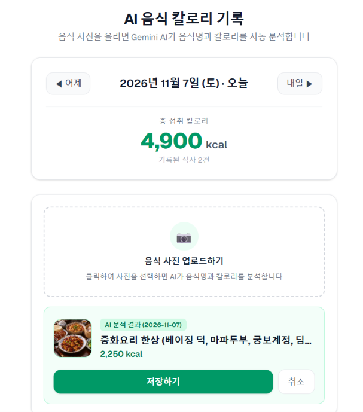

# 🍽️ AI 음식 칼로리 기록 (AI Calorie Tracker)

음식 사진을 업로드하면 **Google Gemini Vision AI**가 음식명과 예상 칼로리(kcal)를 자동으로 분석하고, **Supabase(`meals` 테이블)**에 날짜별로 저장·관리하는 Next.js 웹 애플리케이션입니다.

---

## 📸 실행 화면



---

## ✨ 주요 기능

1. **AI 음식 사진 칼로리 분석 (Gemini API)**
   - 음식 사진을 업로드하면 자동으로 리사이즈 및 썸네일을 생성한 뒤 Gemini AI(`gemini-2.5-flash`)가 한국어 음식명(`food_name`)과 예상 칼로리(`calories`)를 분석합니다.
2. **분석 결과 미리보기 및 Supabase 저장 (`저장하기`)**
   - 분석된 음식명과 칼로리를 확인한 후 **`저장하기`** 버튼을 클릭하면 Supabase 클라이언트를 통해 `meals` 테이블에 저장하고 즉시 식사 목록을 새로 불러옵니다.
   - 저장 실패 시 화면에 `'저장에 실패했습니다. 다시 시도해주세요'` 안내 메시지를 표시합니다.
3. **일별 식사 목록 및 총 섭취 칼로리 대시보드**
   - 선택된 날짜(기본값: 오늘)에 기록된 식사 건수와 **총 섭취 칼로리(kcal)**를 상단에 한눈에 표시합니다.
   - 각 식사 기록은 음식 썸네일, 음식명, 기록 시간, 칼로리가 포함된 깔끔한 **카드형 목록**으로 제공됩니다.
4. **개별 식사 기록 삭제 (`✕` 버튼)**
   - 각 식사 카드 우측의 삭제 버튼(`✕`)을 눌러 개별 식사 기록을 즉시 삭제할 수 있습니다.
5. **날짜 이동 (`◀ 어제` / `내일 ▶`)**
   - 상단의 날짜 이동 버튼으로 어제·내일 등 다른 날짜의 식단 기록을 자유롭게 조회하고 기록할 수 있습니다.

---

## 🛠️ 기술 스택

- **Framework**: Next.js 16 (App Router, Turbopack), React 19, TypeScript
- **Styling**: Tailwind CSS v4 (화이트 톤 카드형 UI)
- **Database**: Supabase (`@supabase/supabase-js`)
- **AI Model**: Google Gemini API (`gemini-2.5-flash`)

---

## 🗄️ 데이터베이스 구조 (`public.meals`)

Supabase SQL Editor에서 [`supabase/schema.sql`](./supabase/schema.sql)을 실행하여 테이블을 생성합니다.

| 컬럼명 | 타입 | 제약 조건 | 설명 |
| :--- | :--- | :--- | :--- |
| `id` | `uuid` | `PRIMARY KEY`, `default gen_random_uuid()` | 식사 기록 고유 ID |
| `food_name` | `text` | `NOT NULL` | 분석된 한국어 음식명 |
| `calories` | `integer` | `NOT NULL` | 분석된 칼로리 (kcal) |
| `meal_date` | `date` | `NOT NULL`, `default current_date` | 식사 날짜 (`YYYY-MM-DD`) |
| `image_url` | `text` | `NULL` | 음식 사진 썸네일 (Data URL) |
| `created_at` | `timestamptz` | `NOT NULL`, `default now()` | 생성 일시 |

---

## 🚀 시작하기

### 1. 패키지 설치

```bash
npm install
```

### 2. 환경변수 설정 (`.env.local`)

프로젝트 루트에 `.env.local` 파일을 생성하고 아래 값을 입력합니다.

```env
NEXT_PUBLIC_SUPABASE_URL=https://your-project.supabase.co
NEXT_PUBLIC_SUPABASE_PUBLISHABLE_KEY=your_supabase_publishable_or_anon_key
GEMINI_API_KEY=your_google_gemini_api_key
```

### 3. 개발 서버 실행

```bash
npm run dev
```

브라우저에서 [http://localhost:3000](http://localhost:3000)으로 접속하여 확인합니다.
